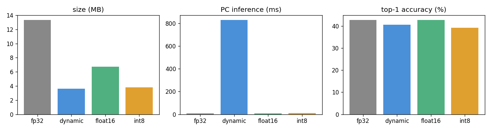

# 온디바이스 실시간 사물 인식기: PTQ 경량화 4종 비교

라즈베리파이 5 카메라로 사물을 실시간 인식하면서, 같은 모델을 **4가지 방식으로 경량화**했을 때
크기 / 속도 / 정확도가 어떻게 달라지는지 직접 비교하는 프로젝트입니다.
화면을 터치하면 모델이 바뀌어서 속도 차이를 실시간으로 볼 수 있습니다.

- 모델: ImageNet 1000종 사전학습 **MobileNetV2** (학습 없음, 변환만)
- 경량화: 강의자료의 PTQ 3종 + 기준선
- 평가: 공개 데이터셋 ImageNet-V2에서 카메라로 직접 보여줄 수 있는 일상 물건 23종(종류당 10장, 정답 라벨 있음)을 골라 6장은 정확도 평가, 4장은 INT8 보정에 사용

| 모델 파일 | 방식 | 설명 |
|---|---|---|
| `mobilenet_fp32.tflite` | 기준선 | 원본 그대로 변환 |
| `mobilenet_dynamic.tflite` | Dynamic range | 가중치만 8비트로 |
| `mobilenet_float16.tflite` | Float16 | 가중치를 16비트로 |
| `mobilenet_int8.tflite` | Full integer INT8 | 가중치+연산 모두 8비트, 내 사진으로 보정(calibration) |

## 환경 (PC와 라즈베리파이 버전 일치)

| | PC (Windows, 변환/검증) | Raspberry Pi 5 (실시간 실행) |
|---|---|---|
| Python | 3.11 | 3.11 (pyenv `.venv311`) |
| numpy | 1.26.4 | 1.26.4 |
| TFLite 엔진 | tensorflow 2.14.1 (`tf.lite`) | tflite-runtime 2.14.0 |
| OpenCV | opencv-python 4.10.0.84 | opencv-python 4.10.0.84 |

tflite-runtime은 Windows 버전이 없어서 PC에서는 같은 2.14 엔진이 들어있는 tensorflow 2.14.1을 씁니다.

## 파일

| 파일 | 역할 | 실행 위치 |
|---|---|---|
| `convert_models.ipynb` | 사전학습 모델 → TFLite 4종 변환, 크기/속도/일치율 비교 | PC (VS Code) |
| `object_cam.py` | 실시간 인식 데모 (카메라/사진/동영상), `--bench` 속도 측정 | PC, 라즈베리파이 |
| `check_env.py` | 버전 확인 | PC, 라즈베리파이 |
| `images/` | (선택) 내 사물 사진, INT8 보정에 추가 | PC |
| `GUIDE.md` | 단계별 따라하기 | - |

## 결과 (PC, 2026-11-24)

| 모델 | 크기(MB) | PC 추론(ms/장) | top-1 정확도(%) | Pi 추론(ms/장) |
|---|---|---|---|---|
| fp32 | 13.34 | 6.84 | 약 43 | 측정 예정 |
| dynamic | 3.62 | 710.38 | 약 41 | 측정 예정 |
| float16 | 6.71 | 6.59 | 약 43 | 측정 예정 |
| int8 | 3.81 | 7.73 | 약 39 | 측정 예정 |

- PC: Windows x86, TFLite 2.14 (XNNPACK CPU 가속), 정확도는 ImageNet-V2 일상 물건 23종 138장 기준 (정확한 값: `ptq_result.csv`)
- **크기**: float16은 약 1/2, dynamic·int8은 약 1/4로 줄어듦
- **정확도**: float16은 손실 없음, int8은 약 4%p 하락. 사진별 비교에서 fp32와 int8 예측이 23장 중 19장 같음 (달라진 것은 원본도 애매하던 사진)
- **속도**: dynamic만 약 100배 느림. XNNPACK 가속이 dynamic range 방식을 지원하지 않기 때문 → 파일이 작다고 빠른 것이 아니라 하드웨어/런타임 지원이 있어야 빨라짐
- PC(x86)에서는 int8이 fp32보다 빠르지 않음 → 다음 단계에서 라즈베리파이(ARM)에서 비교 예정

## 진행 상황
- [x] 주제 선정, PC/라즈베리파이 버전 맞춘 코드 작성
- [x] PC: 모델 변환 및 비교
- [x] PC: 사진으로 데모 검증 + 속도 측정
- [ ] 라즈베리파이: 카메라 실시간 실행 + 추론 시간 측정
- [ ] 결과 정리 및 발표
